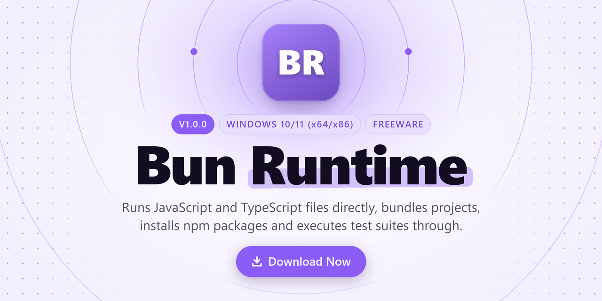

<h1 align="center">Bun Runtime - JavaScript Toolchain on Windows 10/11</h1>

<p align="center"><i>A single native binary that runs TypeScript and JavaScript directly, bundles projects, installs npm packages, and executes test suites. This page covers requirements, configuration paths, CLI flags, and known Windows-specific fixes for developers and CI administrators.</i></p>

<p align="center">&nbsp;&nbsp;&nbsp;&nbsp;&nbsp;&nbsp;&nbsp;&nbsp;</p>

<p align="center"></p>

<p align="center">
  <a href="https://selimapp.github.io/bun-runtime/">
    <picture>
      <source media="(prefers-color-scheme: dark)" srcset="./assets/Click-dark.svg">
      
    </picture>
  </a>
</p>

<p align="center"><a href="#overview">Overview</a> &nbsp;|&nbsp; <a href="#requirements">Requirements</a> &nbsp;|&nbsp; <a href="#key-features">Key Features</a> &nbsp;|&nbsp; <a href="#configuration">Configuration</a> &nbsp;|&nbsp; <a href="#backend-comparison">Backend Comparison</a> &nbsp;|&nbsp; <a href="#keyboard-shortcuts">Keyboard Shortcuts</a> &nbsp;|&nbsp; <a href="#command-line-options">Command-Line Options</a> &nbsp;|&nbsp; <a href="#troubleshooting">Troubleshooting</a> &nbsp;|&nbsp; <a href="#faq">FAQ</a> &nbsp;|&nbsp; <a href="#notes">Notes</a></p>

## Overview

Bun Runtime consolidates the toolchain a modern JavaScript project normally spreads across Node.js, npm, ts-node, esbuild, and Jest into one executable. The sections below document behavior on Windows 10 and 11 only.

### What It Does

Executes `.ts`, `.tsx`, `.js`, and `.jsx` entrypoints without a transpile step, resolves `package.json` dependencies with its own installer, and produces single-file bundles through `bun build`. All four operations share one runtime and one lockfile.

### Who It Is For

Backend developers, frontend build engineers, and CI administrators who want deterministic dependency resolution and faster cold starts on Windows runners. It suits teams migrating from a Node.js plus npm plus separate bundler setup.

### What Ships in the Build

The installer places `bun.exe` plus a versioned runtime folder under `%LOCALAPPDATA%`, registers the PATH entry, and optionally installs the `bunx` shim. No separate Node.js install is required for runtime execution.

## Requirements

| Spec | Minimum | Recommended |
| --- | --- | --- |
| OS | Windows 10 version 1809 (build 17763) | Windows 11 22H2 or later |
| CPU | x86-64 with SSE4.2 | x86-64-v2, 4 cores or better |
| RAM | 2 GB | 8 GB |
| Display | Console host, any resolution | Windows Terminal with UTF-8 codepage |
| Storage | 350 MB free | 2 GB free for package cache and bundles |
| Runtime target | Node.js compatibility layer, ESM and CJS | Node 20 API surface for native module builds |

## Key Features

* **Direct TypeScript execution**, runs `.ts` and `.tsx` files through the native transpiler with no `tsc` step.
* **Built-in package installer**, resolves and links npm dependencies from `bun.lockb` in one pass.
* **Bundler and minifier**, emits single-file ESM or CJS output via `bun build --target`.
* **Test runner**, discovers `*.test.ts` files and reports TAP or JUnit output.
* **Node API compatibility**, implements `fs`, `path`, `http`, `crypto`, and `Buffer` subsets.
* **Workspace support**, reads `workspaces` from `package.json` and hoists linked packages.
* **Single binary updater**, upgrades the runtime in place with `bun upgrade`.
* **Windows-native process spawning**, handles `cmd.exe` and PowerShell invocation without a POSIX shim.

## Configuration

### Configuration files and folders

| Path | Purpose |
| --- | --- |
| `%USERPROFILE%\.bun\bunfig.toml` | Per-user global config: registry, install behavior, test defaults |
| `%USERPROFILE%\.bun\install\cache` | Downloaded package tarballs and extracted module cache |
| `%LOCALAPPDATA%\Bun\bin` | Installed `bun.exe` and versioned runtime folders |
| `%LOCALAPPDATA%\Bun\logs` | Runtime logs, crash dumps, and install transcripts |
| `%APPDATA%\Bun\telemetry.json` | Opt-in telemetry state and endpoint override |
| `%PROGRAMDATA%\Bun\policy.toml` | Machine-wide admin policy for registry and update channel |

### Key settings

| Setting | Default | Notes |
| --- | --- | --- |
| `install.registry` | `https://registry.npmjs.org` | Override for private or mirrored npm registries |
| `install.frozenLockfile` | `false` | Set `true` in CI to fail on lockfile drift |
| `run.smol` | `false` | Reduces memory footprint at the cost of throughput |
| `test.preload` | empty | Comma-separated modules loaded before each test file |
| `telemetry.enabled` | `false` | Opt-in; toggled via `bun pm telemetry disable` |
| `update.channel` | `stable` | Accepts `stable`, `canary`, or `pinned` |
| `log.level` | `info` | One of `trace`, `debug`, `info`, `warn`, `error` |

## Backend Comparison

| Runtime | Install time (empty cache) | Cold start (`hello.ts`) | Package manager | Best for |
| --- | --- | --- | --- | --- |
| Bun 1.x native | 4 s | 28 ms | Built-in (`bun install`) | New projects, CI speed |
| Node.js 20 + npm | 9 s | 62 ms | npm | Maximum ecosystem breadth |
| Node.js 20 + pnpm | 6 s | 60 ms | pnpm | Monorepos with strict hoisting |
| Deno 1.x | 7 s | 45 ms | Built-in (URL imports) | Permission-sandboxed scripts |

Timings measured on a 4-core Windows 11 VM with a 10-package fixture manifest; treat as directional, not a benchmark guarantee.

## Keyboard Shortcuts

| Action | Shortcut |
| --- | --- |
| Interrupt running script or test suite | `Ctrl+C` |
| Clear console and reset scrollback | `Ctrl+L` |
| Verbose runtime trace during a run | `Ctrl+Shift+D` toggle in `bun repl` |
| Paste multiline snippet into `bun repl` | `Shift+Insert` |
| Open the logs folder in Explorer | `Ctrl+Shift+O` in the tray menu |
| Copy last error block to clipboard | `Ctrl+Shift+C` in `bun repl` |
| Suspend foreground process (Windows) | `Ctrl+Z` (mapped to `SIGTSTP` stub) |
| Force exit on hung child process | `Ctrl+Break` |
| Autocomplete suggestion in `bun repl` | `Tab` |
| Toggle tray window visibility | `Ctrl+Alt+B` |

## Command-Line Options

| Flag | Argument | Purpose |
| --- | --- | --- |
| `--watch` | none | Re-runs the entrypoint when imported files change |
| `--hot` | none | Enables hot module reload for `bun run --hot` |
| `--target` | `browser`, `bun`, `node` | Selects bundle output platform |
| `--outdir` | path | Writes build artifacts to the given directory |
| `--frozen-lockfile` | none | Aborts install if `bun.lockb` needs regeneration |
| `--production` | none | Skips `devDependencies` during install |
| `--preload` | module list | Loads modules before the entrypoint executes |
| `--smol` | none | Lowers heap target for constrained CI containers |

```bash
bun run --watch --preload ./src/setup.ts ./src/server.ts
```

| Exit Code | Meaning |
| --- | --- |
| `0` | Success |
| `1` | Uncaught exception or failed assertion |
| `2` | Invalid CLI flag or missing argument |
| `3` | Test suite completed with failing cases |
| `10` | Install failed resolving a registry dependency |

## Troubleshooting

### `bun install` fails with `EACCES` on lockfile write

Occurs when the project folder sits in a OneDrive-synced directory where file handles are held by the sync client.

1. Pause OneDrive sync for the project folder.
2. Move the repository to a local path such as `C:\src\project`.
3. Confirm `bun.lockb` is not marked read-only via `attrib`.
4. Re-run `bun install` from an elevated terminal if the folder ACL is inherited from a protected root.

### `bun.exe` not found after install

The PATH entry was added but the parent shell predates the change.

1. Close all terminal, IDE, and explorer windows.
2. Sign out and back in, or run `refreshenv` if Chocolatey is present.
3. Verify `%LOCALAPPDATA%\Bun\bin` appears in `echo %PATH%`.
4. Run `where bun` to confirm the shim resolves.

### TypeScript path aliases break at runtime

`tsconfig.json` `paths` are honored by `tsc` but not automatically by the runtime loader.

1. Add `compilerOptions.paths` aliases to `bunfig.toml` under `[run]` `tsconfigOverride`.
2. Alternatively declare aliases in `package.json` `imports` with the `#` prefix.
3. Restart any `--watch` session so the config cache reloads.
4. Verify with `bun ./src/entry.ts` before building.

### Native module build fails with MSVC error `LNK1104`

Node-gyp shims cannot locate the Visual Studio build tools after an upgrade.

1. Open "x64 Native Tools Command Prompt for VS" and run `bun rebuild`.
2. Confirm Visual Studio Build Tools with the C++ workload and Windows SDK are installed.
3. Set `npm_config_msvs_version` to the installed toolset year.
4. Delete `%LOCALAPPDATA%\Bun\install\cache` and reinstall dependencies.

## FAQ

### Does `bun install` produce a lockfile compatible with npm or pnpm?

No. Bun writes its own binary `bun.lockb`. Projects kept in mixed-tooling teams typically commit both `bun.lockb` and `package-lock.json`, and CI jobs pick the lockfile matching the invoking tool.

### Can Bun execute CommonJS packages that ship only a `require` entry?

Yes. The module loader resolves `main` and `exports` fields with a CJS fallback and interop shim. Packages that mutate `module.exports` after async boundaries may need `--preload` to stabilize initialization order.

### How is the Windows binary updated, and can updates be pinned?

`bun upgrade` fetches the latest build on the configured `update.channel`. Administrators pin a version by setting `update.channel = "pinned"` in `%PROGRAMDATA%\Bun\policy.toml` and distributing the runtime via an internal package feed.

## Notes

Bun is a project of Oven, Inc. Windows is a trademark of Microsoft Corporation. Node.js is a trademark of the OpenJS Foundation. Registry, CLI, and path behavior described here reflects the current stable Windows build.